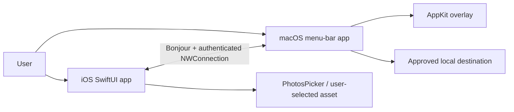
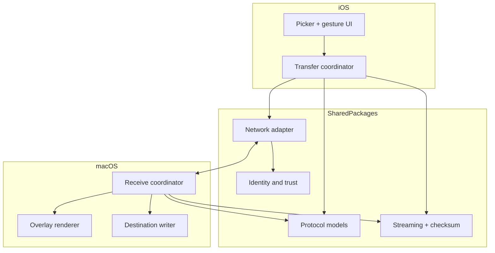
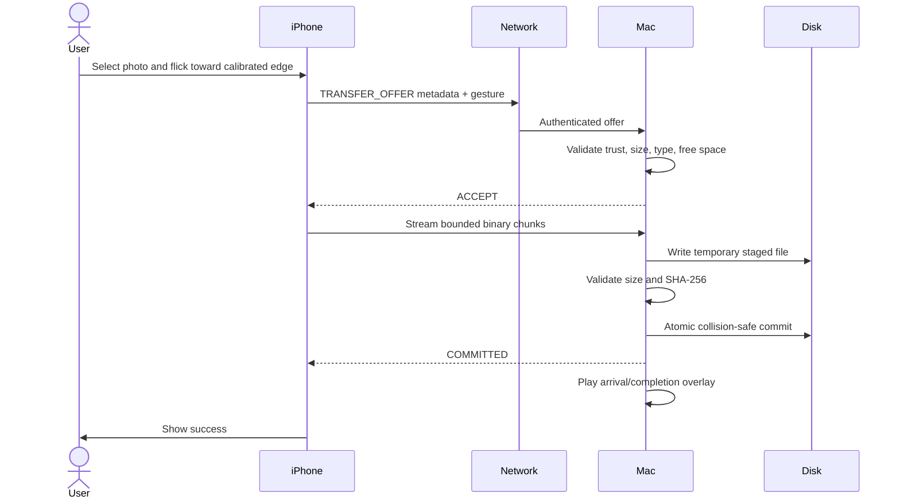

# Architecture Document — Spatial Bridge
Version 1.0 | Architecture status: Proposed

## 1. Architecture overview
Two native clients communicate over an authenticated local network connection. The Mac usually advertises a Bonjour service; the iPhone browses and initiates the connection. The architecture deliberately separates the control plane (discovery, pairing, gesture, offers, acknowledgments) from the data plane (bounded binary file streaming). Neither client needs a backend service for local transfers.

## 2. Context diagram

## 3. Component diagram

## 4. Transfer sequence

The Mac may play a provisional arrival animation on accepted offer or first-byte receipt, but the final success state must wait for committed save.

## 5. Bounded contexts
- Discovery and connection: NWBrowser/NWListener/NWConnection lifecycle.
- Trust: identity, pairing approval, trusted-peer store, revocation.
- Transfer: framing, backpressure, chunking, hash, idempotency, retry.
- Gesture and calibration: iOS touch interpretation and cross-device coordinate mapping.
- Presentation: macOS overlay, fallback notifications, status.
- Storage: sandbox bookmarks, staging, atomic save, metadata-only history.

## 6. Security architecture
Trust boundary 1: arbitrary LAN peer → discovery is untrusted. Boundary 2: pair approval → verify cryptographic peer identity and short code. Boundary 3: authenticated transfer → validate every message and enforce quotas. Boundary 4: untrusted filename/content → sanitize and write only within approved destination. Threats: impersonation, malicious Bonjour records, replay, path traversal, oversized frames, disk exhaustion, tampered chunks, unauthorized pairing, sensitive log leakage. Mitigations: pinned peer identities, authenticated encrypted sessions, nonces, length caps, allowlisted file policy, checksum, rate limiting and safe paths.

## 7. Reliability and idempotency
Each transfer has UUID and explicit state; receiver records terminal outcome so repeated COMPLETE/offer cannot create duplicate files. Timeouts and disconnects close stream and retain only controlled temporary state. Resume-by-offset is P1 and requires authenticated state revalidation; MVP restarts transfer cleanly.

## 8. Performance model
Time-to-completion = discovery/pairing (amortized for trusted peers) + offer roundtrip + file bytes/effective throughput + hash verification + disk commit. Render initial arrival on offer acceptance to make the interaction feel immediate without misrepresenting final file delivery. Instrument P50/P95 and benchmark different sizes and Wi-Fi conditions.

## 9. Deployment and runtime constraints
Mac companion can run as LSUIElement menu-bar accessory while user session is active; it is not a privileged system daemon. iOS background execution is constrained; reliable initiation assumes foreground app. Network connectivity depends on LAN reachability, privacy permission, VPN/router isolation and OS behavior. BLE RSSI cannot verify actual phone-below-Mac arrangement.

## 10. Architecture decision records
- ADR-001: Network.framework primary; MPC deprecated and not core dependency.
- ADR-002: Bonjour for discovery; explicit cryptographic trust for identity.
- ADR-003: Separate Codable control DTOs from binary file streams.
- ADR-004: Manual edge calibration; no claimed physical-position sensing.
- ADR-005: User-selected folder with security-scoped bookmark.
- ADR-006: Native SwiftUI + AppKit; SPM shared libraries.
- ADR-007: One concurrent transfer MVP; bounded backpressure.
- ADR-008: Overlay is best-effort visual layer; notification fallback.

## 11. Quality gates
Architecture review; threat modeling; authenticated transport tests; protocol fuzzing; crash-free transfer sessions; accessibility review; on-device energy and memory profiling; LAN/guest Wi-Fi/VPN test matrix; macOS Spaces/full-screen tests; reproducible signing and release build.

## 12. Future extensibility
Support batches and folders, reverse Mac→iPhone transfers, multi-peer device routing, optional local WebSocket transport adapter, share extension for supported file handoff, richer animation physics and optional cross-platform clients behind the shared versioned protocol. Do not promise unsupported OS-wide drag gestures.

## Research and platform constraints (20 October 2026)
- Apple marks MultipeerConnectivity deprecated; use Network.framework with Bonjour service discovery for the primary implementation. Legacy MPC can be a separately tested fallback, not a mandatory dependency.
- Bonjour browsing and advertising require local-network privacy authorization and declared service types in Info.plist. Test actual behavior on both supported OS versions.
- BLE RSSI is not proof of proximity, direction, or device ownership. The MVP uses user-confirmed pairing and manual spatial calibration; BLE is optional discovery assistance only.
- The iOS gesture works inside this application's UI only; no global Photos-app interception or system-wide drag-off-screen hooks.
- A macOS sandboxed app should ask the user to choose its destination folder and persist a security-scoped bookmark; Desktop is a suggested selection, not an unconditional writable path.
- File metadata/control messages must be separated from binary streaming. No large Data fields in Codable JSON.

### Research references
1. Apple Multipeer Connectivity deprecation: https://developer.apple.com/documentation/multipeerconnectivity
2. Apple local network privacy TN3179: https://developer.apple.com/documentation/technotes/tn3179-understanding-local-network-privacy
3. Apple sandbox file access: https://developer.apple.com/documentation/security/accessing-files-from-the-macos-app-sandbox
4. Apple NSOpenPanel: https://developer.apple.com/documentation/appkit/nsopenpanel
5. Apple NSWindow full-screen auxiliary: https://developer.apple.com/documentation/appkit/nswindow/collectionbehavior-swift.struct/fullscreenauxiliary

> Targets, performance thresholds and schedules below are proposed acceptance targets, not measured claims. Validate APIs, entitlements, signing, and deployment against the Xcode SDK used for release.
